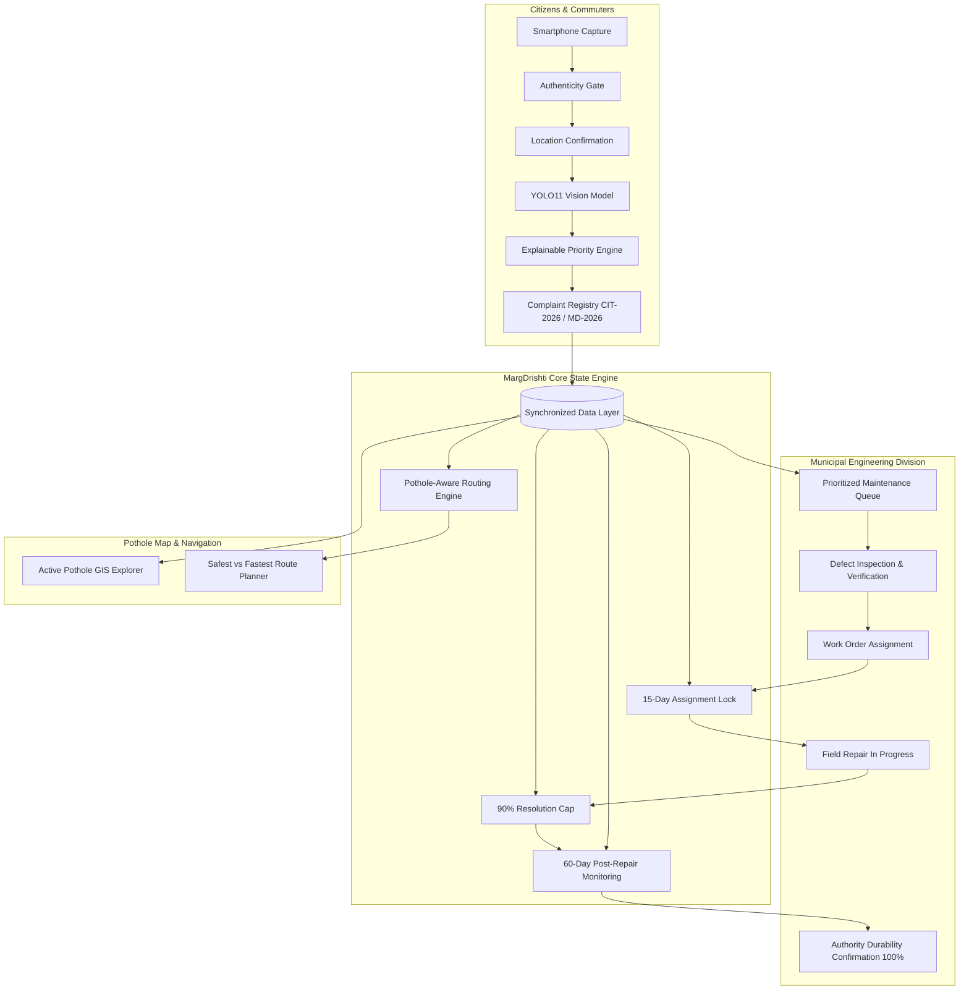

# MargDrishti — Smarter Roads. Safer Journeys.

[](LICENSE)
[]()
[]()

> **AI-Powered Road Damage Reporting, Explainable Prioritization & Maintenance Tracking**

MargDrishti is a civic-technology prototype designed to connect road-damage evidence with location information, an explainable priority score, an authority maintenance workflow, and citizen complaint tracking.

> **Current implementation note:** The frontend currently uses demo/mock AI analysis for illustrating the workflow. It does not yet perform genuine YOLO11 inference on uploaded image pixels or video frames. The trained model integration is a future step. Demo results and sample data must not be interpreted as live AI or live government data.

---

## 📌 Problem Statement

Road damage can create safety risks, disrupt travel, and be difficult for authorities to prioritize when reports arrive through disconnected channels. MargDrishti demonstrates a more structured workflow: citizens submit image or video evidence, attach a location, view a prototype priority assessment, and track the complaint while authorities review and update the maintenance status.

The project's intended value is not only damage detection. It is the connected workflow:

**CAPTURE → DETECT → LOCATE → PRIORITIZE → TRACK → RESOLVE**

---

## 🌟 Current Features

1. **Citizen and Authority interfaces**  
   Separate citizen-facing and authority-facing views support the main reporting and maintenance workflow.

2. **Image and video upload previews**  
   The frontend supports media selection and preview for the reporting flow, subject to browser-supported formats and current project validation.

3. **Location capture and fallback**  
   Browser geolocation can be used where permission and device support allow it. A manual or demo-location fallback should be clearly identified as such; demo coordinates are not the user's live location.

4. **AI Analysis Demo**  
   A mock AI service returns example damage labels, confidence values, severity, and detection-box data to demonstrate the intended result screen. These values are predefined demo outputs, not model predictions from the uploaded media.

5. **Prototype explainable priority score**  
   The priority engine demonstrates how damage severity and other factors can contribute to a 0–100 priority score. The formula is a prototype model, not an officially validated government standard.

6. **Complaint reporting and tracking**  
   The workflow is designed to create complaint records, show their details, and track status changes.

7. **Authority maintenance workflow**  
   The authority interface supports reviewing the queue and managing complaint actions such as assignment, status updates, notes, and resolution evidence where those controls are connected in the current build.

8. **Shared data and persistence**  
   The project includes frontend demo/local state and a Node.js/Express backend with PostgreSQL integration. Which data source is used depends on the connected flow; verify persistence in the running environment before presenting it as database-backed end to end.

### Current limitations

- Real YOLO11 inference is **not yet connected to the current mock AI service**.
- Video frame counts, timestamps, and confidence values returned by the demo service are illustrative, not calculated from the uploaded video.
- The prototype does not claim live integration with a municipal authority, official government GIS, live traffic data, or government road databases.
- Features that are not connected and tested in the running build should be presented as planned functionality, not as completed functionality.

---

## 🏗️ Architecture

The diagram below is retained as the **intended product architecture**. Some blocks represent planned capabilities and should not be read as proof that each capability is already implemented in the current prototype.



### Implemented prototype flow

- **Frontend:** HTML, CSS, and JavaScript modules.
- **Backend:** Node.js with Express.
- **Database:** PostgreSQL, using the `margdrishti_semv` database and `road` schema in the current development setup.
- **AI:** Mock/demo service for displaying example analysis results; trained model inference is pending integration.

---

## 🛠️ Technology Stack

| Layer | Current status / technologies |
|---|---|
| **Frontend** | HTML5, CSS3, JavaScript ES modules |
| **Frontend state** | Existing mock services and browser-side state/local storage where used |
| **Backend** | Node.js, Express |
| **Database** | PostgreSQL; current development database: `margdrishti_semv`, schema: `road` |
| **AI analysis** | JavaScript mock service returning illustrative image/video analysis results |
| **Planned computer vision** | Python, PyTorch, OpenCV, trained YOLO11 weights (`best.pt`) |
| **Planned model integration** | Connect a real image/video inference service to the existing application flow |

---

## 📁 Repository Structure

The project has a frontend folder and a backend folder. The exact files may vary with the current local checkout; preserve the existing project structure when making changes.

```text
MargDrishti/
├── Prototye_MardDrishti/      # Frontend prototype (HTML, CSS, JavaScript)
│   ├── index.html             # Main entry page
│   ├── css/                   # Stylesheets, if present
│   └── js/                    # Frontend modules and services, if present
├── backend/                   # Node.js / Express API
│   ├── server.js              # Backend entry point (if named this in your checkout)
│   └── ...                    # Routes, database connection, and related modules
├── README.md                  # Project documentation
└── LICENSE                    # License file, if included
```

---

## 🚀 How to Run the Prototype

Run the frontend and backend using the paths and scripts in your local checkout. The commands below reflect the current development setup; adjust the folder path if your project is stored elsewhere.

### 1. Start the backend

Open PowerShell or a terminal in the `backend` folder:

```bash
node server.js
```

The backend is expected to run on port `5000` in the current setup. Keep this terminal open. If the project uses an npm start script or a different entry file in your checkout, use the command defined by its `package.json`.

### 2. Open the frontend

Open the frontend folder and serve `index.html` using VS Code Live Server or another local HTTP server. For example, from the frontend directory:

```bash
python -m http.server 5500
```

Then open the local URL shown by the server, such as `http://127.0.0.1:5500/index.html`.

### 3. Database

Ensure PostgreSQL is running and that the backend's database connection settings match your local environment. The current development setup uses the `margdrishti_semv` database and `road` schema. Do not publish database passwords or other secrets in this README or commit them to Git.

### Important

The frontend's demo/local state and the PostgreSQL-backed API may not be connected for every screen. Test the complete Citizen → Authority → Citizen flow in your current build before claiming that every update persists to PostgreSQL.

---

## 🔮 Next Steps

- Obtain and verify the original trained YOLO11 `.pt` checkpoint.
- Integrate the model through a Python inference service and test it with real road images.
- Implement actual sampled-frame video inference before displaying real frame counts or timestamps.
- Connect analysis results, complaint records, and authority status changes through one verified source of truth.
- Test geolocation permissions, manual/demo fallback, file validation, error states, and refresh persistence.
- Validate the prototype with representative road images and videos before describing detection performance.

---

## 👥 Project

- **Project:** MargDrishti — Smarter Roads. Safer Journeys.
- **Focus:** Road damage reporting, explainable prioritization, and maintenance tracking.
- **License:** [MIT License](LICENSE), if the included license file applies.

**Capture road damage. Detect with the connected model when available. Locate the issue. Prioritize what matters. Track it to resolution.**
