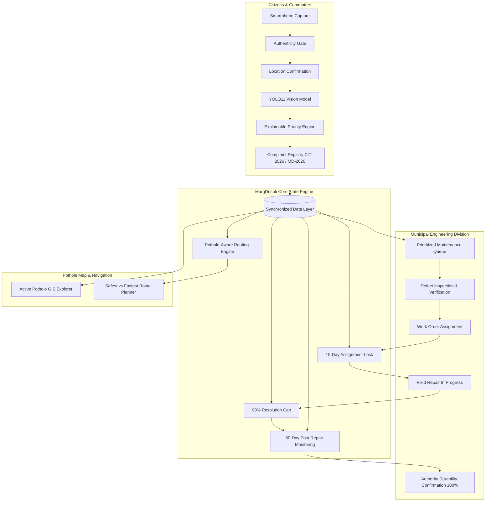

# MargDrishti — Smarter Roads. Safer Journeys.

<p align="center">
  <strong>AI-Powered Road Damage Reporting, Explainable Prioritization & Maintenance Tracking</strong>
</p>

<p align="center">
  
  
  
  
  
</p>

MargDrishti is a civic-technology project designed to make road-damage reporting more structured and transparent. It connects citizen-submitted road evidence with location information, explainable priority assessment, authority maintenance workflows, and complaint tracking.

The goal is to help citizens report road damage and help authorities understand which reported issues may require attention first.

**CAPTURE → DETECT → LOCATE → PRIORITIZE → TRACK → RESOLVE**

> **Prototype transparency:** AI capabilities, persistence, and external integrations must be evaluated according to the current running implementation. Mock AI results, sample records, and fallback locations must not be interpreted as real model predictions, live government data, or confirmed real-world repairs.

## Table of Contents

- [Problem Statement](#problem-statement)
- [Solution](#solution)
- [Features](#features)
- [System Architecture](#system-architecture)
- [Technology Stack](#technology-stack)
- [Project Structure](#project-structure)
- [Getting Started](#getting-started)
- [Database Configuration](#database-configuration)
- [AI Analysis and Priority Model](#ai-analysis-and-priority-model)
- [Current Limitations](#current-limitations)
- [Future Scope](#future-scope)
- [Security Notes](#security-notes)
- [Contributing](#contributing)
- [License](#license)

---

## Problem Statement

Road damage can create safety risks, disrupt daily travel, and increase vehicle maintenance costs. When reports arrive through disconnected channels, it can be difficult to organize evidence, understand the location of a defect, prioritize maintenance, and keep citizens informed.

MargDrishti explores a connected digital workflow that allows citizens to report road damage and follow complaint progress while authorities review reports and coordinate maintenance.

## Solution

MargDrishti brings the major steps of road-damage reporting into one application:

1. **Capture:** Citizens select road-damage evidence using an image or supported video format.
2. **Detect:** The application presents road-damage analysis through its available AI service.
3. **Locate:** Citizens can provide location information using device geolocation or an explicitly identified fallback.
4. **Prioritize:** An explainable scoring model helps communicate the factors influencing a complaint's priority.
5. **Track:** Citizens can view complaint information and status updates.
6. **Resolve:** The authority workflow supports maintenance actions and resolution evidence where implemented.

The project focuses on the complete reporting and maintenance workflow, rather than treating road-damage detection as an isolated task.

## Features

### Citizen Dashboard

- Road-damage reporting workflow.
- Image and supported video file selection with previews.
- Location capture where browser permission and device support allow it.
- Manual or demo-location fallback where available.
- Complaint information and tracking.
- Status and priority visibility.

### Authority Dashboard

- Complaint review and maintenance queue.
- Complaint details and available evidence.
- Priority and severity information.
- Assignment and status-management controls where connected.
- Repair notes and resolution evidence where supported.

### AI Analysis

- Analysis-result interface for supported road-damage categories, such as potholes and cracks.
- Confidence, severity, and detection visualization when provided by the connected analysis service.
- Image and video result presentation according to the implemented processing method.

**Note:** The displayed model name, confidence, bounding boxes, frame counts, and timestamps must reflect the actual inference implementation. If mock analysis is active, results are illustrative and are not predictions made from the uploaded media.

### Explainable Priority Assessment

MargDrishti uses a prototype priority model to communicate how multiple factors can influence maintenance urgency.

The intended factors are:

| Factor                  |   Weight |
| ----------------------- | -------: |
| Damage Severity         |      30% |
| Damage Extent           |      20% |
| Road Importance         |      20% |
| Traffic Exposure        |      10% |
| Sensitive Location Risk |      10% |
| Corroborating Evidence  |      10% |
| **Total**               | **100%** |

The intended score is on a scale of 0–100. The values shown for each complaint should be calculated from available data and clearly documented assumptions.

This is a **Prototype Explainable Priority Model**, not an officially validated government formula.

### Complaint Lifecycle

The intended workflow connects citizen reporting with authority review, assignment, maintenance progress, and resolution.

The exact persistence and status transitions depend on the backend and frontend flows connected in the current build.

---
## 🏗️ Architecture

The diagram below is retained as the **intended product architecture**. Some blocks represent planned capabilities and should not be read as proof that each capability is already implemented in the current prototype.



The diagram represents the intended connected workflow. It does not imply that every service, AI integration, or database-backed interaction has been independently verified in every screen.

### Implemented project layers

- **Frontend:** HTML, CSS, and JavaScript modules.
- **Backend:** Node.js and Express.
- **Database:** PostgreSQL.
- **AI analysis:** The analysis service currently configured in the project.
- **Location:** Browser geolocation where supported, with fallback behavior where implemented.

---

## Technology Stack

| Layer                     | Technology                               |
| ------------------------- | ---------------------------------------- |
| Frontend                  | HTML5, CSS3, JavaScript ES modules       |
| Backend                   | Node.js, Express                         |
| Database                  | PostgreSQL                               |
| Computer vision direction | YOLO11, PyTorch, OpenCV                  |
| Development tools         | Visual Studio Code, pgAdmin, Git, GitHub |

The computer-vision technologies describe the intended model integration. Their inclusion does not, by itself, confirm that trained-model inference is connected to the current application.

---

## Project Structure

The repository is organized into separate frontend and backend directories.

```text
MargDrishti/
├── .vscode/
├── backend/
│   ├── .env                  # Local configuration; do not commit secrets
│   ├── .gitignore
│   ├── db.js                 # Database connection
│   ├── package.json
│   ├── package-lock.json
│   └── server.js             # Express server entry point
├── frontend/
│   ├── index.html            # Landing page
│   ├── citizen.html          # Citizen interface
│   ├── authority.html        # Authority interface
│   ├── map.html              # Map interface
│   ├── css/
│   │   └── margdrishti.css
│   └── js/
│       ├── api.js
│       ├── auth.js
│       ├── citizenApp.js
│       ├── authorityApp.js
│       ├── aiService.js
│       ├── priorityEngine.js
│       ├── geoService.js
│       ├── store.js
│       └── ...
├── README.md
└── verify_full_flow.js
```

This is a representative structure based on the project layout. Individual modules may change as the project evolves.

---

## Getting Started

### Prerequisites

Install the following:

- [Node.js](https://nodejs.org/)
- [PostgreSQL](https://www.postgresql.org/)
- [Visual Studio Code](https://code.visualstudio.com/) or another editor
- A modern web browser

### 1. Clone the repository

```bash
git clone https://github.com/STKIT397/MargDrishti.git
cd MargDrishti
```

### 2. Install backend dependencies

```bash
cd backend
npm install
```

### 3. Configure the database connection

Create or update the local `backend/.env` file using the configuration variables expected by the existing database connection code.

Use your local PostgreSQL credentials and database settings. Do not copy personal passwords into this README or commit the `.env` file.

See [Database Configuration](#database-configuration) below.

### 4. Start the backend

From the `backend` directory:

```bash
node server.js
```

The current development setup uses port `5000`. Confirm the actual port and startup message in the server configuration and terminal.

Keep the backend terminal running.

### 5. Start the frontend

Open a second terminal from the project root:

```bash
cd frontend
python -m http.server 5500
```

Open the address shown by the server, normally:

```text
http://127.0.0.1:5500/
```

For the Citizen, Authority, and other screens, use the corresponding HTML files in the `frontend/` directory.

If you use VS Code Live Server instead, ensure that the frontend API configuration points to the correct backend address.

---

## Database Configuration

The current development database setup uses:

- **Database:** `margdrishti_semv`
- **Schema:** `road`
- **Database engine:** PostgreSQL

The schema includes complaint, location, AI analysis, assignment, status-history, repair, notification, user, authority, and related records.

Before running the application, verify that:

1. PostgreSQL is running.
2. The database exists.
3. The required schema and tables have been created.
4. Backend environment variables match the local database configuration.
5. The database user has the required permissions.

The exact environment-variable names and schema initialization procedure should be taken from the existing backend code and project SQL scripts, if provided. Do not assume that starting the server automatically creates every required table.

---

## AI Analysis and Priority Model

### Road-damage analysis

YOLO11 is the intended computer-vision direction for identifying supported road-damage objects, including potholes and cracks.

A complete integration should process uploaded media using a trained model and return valid detection results such as:

- Damage class
- Confidence
- Bounding-box coordinates
- Severity assessment
- Relevant video-frame information, when genuine video inference is implemented

Until this inference path is connected and tested, the interface must clearly identify mock or demonstration results.

### Priority calculation

The explainable priority model combines six weighted factors to produce a score from 0 to 100.

For each factor:

`Weighted contribution = Normalized factor score × Factor weight`

The final score is the sum of the six weighted contributions.

The implementation should use consistent inputs, documented fallback assumptions, and a single priority-engine implementation. Missing values should not be presented as measured facts.

The score supports prototype prioritization and should not be treated as a substitute for professional road-safety inspection or an official municipal decision.

---

## Current Limitations

The following points should be verified against the running application before a demonstration or release:

- Whether trained YOLO11 weights are loaded and performing real inference on uploaded images.
- Whether video analysis actually samples frames and calculates detection counts and timestamps.
- Whether every complaint and status change is persisted through PostgreSQL or some flows use browser-side state.
- Whether engineer assignment, repair updates, and notifications are connected to shared backend records.
- Whether geolocation is captured from the device or supplied through manual/demo fallback.
- Whether every priority factor is calculated from actual inputs or uses a documented prototype assumption.

Do not present mock results, sample records, or unconnected controls as live production functionality.

---

## Future Scope

Potential improvements include:

- Integration and validation of the trained YOLO11 road-damage model.
- Genuine sampled-frame video inference.
- Consistent backend persistence across Citizen and Authority workflows.
- Improved engineer assignment and notification workflows.
- Better location intelligence and map integration.
- Validation of priority scoring using real road-condition data.
- Testing with representative road images and videos.
- Deployment and operational monitoring.

These are future improvements unless implemented and verified in the current version.

---

## Security Notes

- Never commit database passwords, API keys, access tokens, or private credentials.
- Keep local environment files out of version control.
- Validate uploaded files and incoming API requests.
- Apply authentication and authorization checks to protected operations.
- Do not expose private citizen or engineer information unnecessarily.
- Use parameterized database queries.
- Back up the database before destructive changes.

---

## Contributing

Contributions and suggestions are welcome.

1. Fork the repository.
2. Create a branch for your change.
3. Make a focused modification.
4. Test the affected workflow.
5. Submit a pull request describing the change.

Keep changes aligned with the existing architecture and document any new dependencies or configuration requirements.

---

## License

This project is intended to use the MIT License. See the [`LICENSE`](LICENSE) file for the applicable terms.

---

<p align="center">
  <strong>MargDrishti — Smarter Roads. Safer Journeys.</strong>
  <br />
  Capture road damage. Locate the issue. Prioritize what matters. Track it to resolution.
</p>
